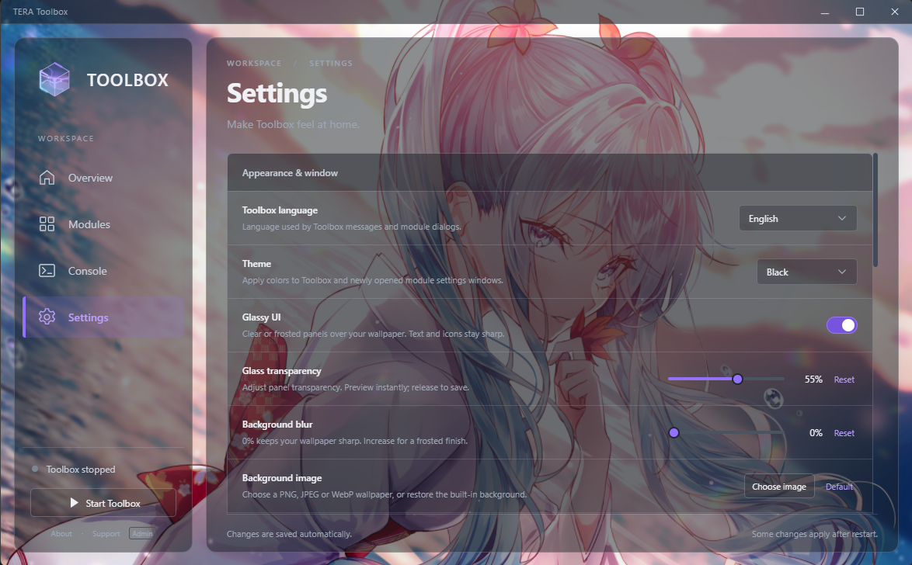

# TERA Toolbox · Graphite

A redesigned TERA Toolbox interface maintained by **CEM**, based on [tera-private-toolbox/tera-toolbox](https://github.com/tera-private-toolbox/tera-toolbox).



The screenshot demonstrates a user-selected wallpaper. That wallpaper is not installed or included as a separate background file; you can choose your own image.

## Download and run

1. Open [Releases](https://github.com/Volframid/tera-toolbox/releases/latest) and download **tera-toolbox-graphite-v1.3.3-windows-x64.zip**. The portable release includes the required runtime. GitHub's automatic “Source code” downloads do not include that runtime.
2. Extract the entire ZIP to a writable folder. Do not run it inside the archive or mix it into an existing Toolbox installation.
3. Run **TeraToolbox.exe**. Internet access is needed for updates and the default modules' first download.
4. Open **Modules** to manage modules, or copy your own modules into this installation's `mods` folder. Use **Start Toolbox**, then start the game as usual.

Windows x64 is required. Protocol/server compatibility follows the underlying Toolbox and the modules you install; a new interface does not add support for every server or patch. The inherited source targets patch 92.03/92.04/100.02. The included runtime is Electron 11.0.5, matching the inherited native components.

## Interface

- **Overview**, searchable **Modules** with list/grid views, **Console** and **Settings**.
- Black, Grey, White and Pink themes, including matching module settings window colors.
- **Toolbox language** applies immediately to navigation, settings, actions and status messages in all eleven selectable languages. The choice is saved for the next launch; Arabic also uses a right-to-left layout.
- **Glassy UI** with independent **Glass transparency** and **Background blur** sliders. Blur covers the entire wallpaper, including gaps and outer edges, while text and controls stay sharp. Leave blur at **0%** for a clear background. White keeps stronger surface shading for readability.
- **Background → Choose file** accepts PNG, JPEG, WebP and animated GIF images (up to 12 MB and 10,000 pixels per side), or MP4 videos (up to 128 MB and 4,096 pixels per side). Videos play silently on repeat and pause when Toolbox is hidden or Glassy UI is off. H.264 MP4 is recommended for compatibility. Glass transparency and blur also apply to animated backgrounds. **Default** restores the built-in abstract background.
- Animated energy cube with flowing interior waves and light trails. **Animated logo** disables it; background/unfocused windows pause it.
- Searchable, filterable console with log export.

Appearance changes save automatically. Wallpapers are copied locally to `data/ui-customizations/user-assets`; they are never uploaded by Toolbox. To apply a changed module-window theme, reopen that module's settings window.

## Included modules

Only the seven upstream default module descriptors are included: `bugfix`, `command`, `fps-utils`, `instant-everything`, `library`, `skill-prediction` and `tera-game-state`. Their original authors and update sources are retained, and their files download through the normal module updater.

**No personal modules, character profiles, saved settings, logs, game modifications or personal wallpaper files are included.** Install your preferred modules separately. If another skill prediction module conflicts with the default one, disable or remove the default `skill-prediction` before enabling your alternative.

## Settings and updates

Fresh installations use `config.example.json` defaults and create their own `config.json`. Automatic Toolbox and module updates are enabled. Toolbox updates use **this repository's `master` branch**, including the Graphite interface; modules continue to use their own authors' update servers.

The self-update manifest excludes personal configuration, installed modules, wallpaper copies and logs. It does not replace your `mods` folder. Keep a backup of your own settings before moving an existing installation.

## Development

See the inherited [Toolbox developer documentation](doc/main.md). The repository contains bundled upstream dependencies; `npm install` alone is not a replacement for the portable distribution. To build a Windows release, download the official runtime ZIP specified in `runtime.json`, then run:

```text
node tools/build-manifest.cjs
python tools/build-release.py --runtime path/to/electron-v11.0.5-win32-x64.zip --output dist
```

Both builders use the explicit `distribution-files.json` allowlist. Extra local files are not packaged. The release builder verifies the runtime's official SHA-256 and writes an archive and checksum file.

## Credits and support

Graphite interface and distribution changes: **CEM**. Original Toolbox: **Caali, Pinkie Pie, meishu** and the upstream contributors. Included components and default modules retain their authors, notices and licenses; see [NOTICE](NOTICE.md).

Report issues for this distribution in [this repository](https://github.com/Volframid/tera-toolbox/issues). Include the problem and relevant logs, after removing private information. The current public release was checked with the bundled Electron runtime and clean default-module metadata; gameplay compatibility still depends on the target server and your installed modules.

## Repair an older custom installation

An older local UI patch can still use the original Toolbox update server, which may replace Graphite launcher icons and core files. Graphite now checks its own update channel before GUI, CLI and periodic update checks.

For an installation still using the old updater, extract the current portable release separately. Its `tools/repair-installation.cjs` can repair an existing installation using the included Electron runtime in Node mode. Pass the existing folder with `--target` and an empty, separate backup folder with `--backup`. The repair verifies all public core checksums and checks writable destinations before copying; it preserves `config.json`, installed modules, profiles, wallpapers and logs. Failed writes restore the copied files from the backup. Keep the existing Toolbox closed while running a manual repair. Core and module updates remain available afterward.
